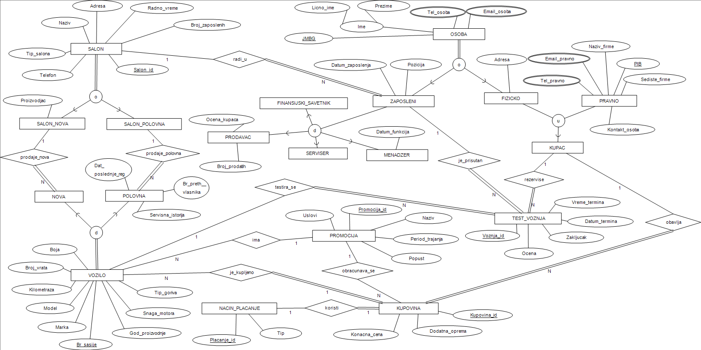

# Auto Salon – Oracle Database System

A car dealership information system built on an Oracle database, with a Windows Forms desktop client and an ASP.NET Core Web API, both using NHibernate as the ORM layer.


> Team project developed for the *Database Systems* course at the Faculty of Electronic Engineering, University of Niš.

## Overview

The project covers the full path from data model to working software:

1. **Database design** – EER model, mapping to a relational model, SQL DDL with integrity constraints and sample data
2. **Desktop application** – Windows Forms client for managing dealerships, vehicles, employees, customers, purchases and test drives
3. **Web API** – RESTful service exposing dealership and employee data, with a shared data-access library

## Database Design



The schema consists of **16 tables** and models several advanced EER concepts:

| Concept | Where it is used |
|---------|------------------|
| Specialization / generalization | `Osoba` → `Zaposleni`, `Fizicko`; `Zaposleni` → salesperson, mechanic, manager, financial advisor |
| Disjoint subclasses | `Vozilo` → `Nova` (new) / `Polovna` (used) vehicles |
| Category (union type) | `Kupac` (customer) is either a natural person (`Fizicko`) or a company (`Pravno`) |
| Multivalued attributes | phone numbers and emails stored in `Tel_osoba`, `Email_osoba`, `Tel_pravno`, `Email_pravno` |
| Integrity constraints | `CHECK` constraints (e.g. new cars have 0 km, used cars > 0 km, fuel type, door count), primary and foreign keys |

Main entities: `Salon`, `Nova`, `Polovna`, `Osoba`, `Zaposleni`, `Fizicko`, `Pravno`, `Kupac`, `Test_voznja`, `Promocija`, `Kupovina`, `Nacin_placanja`.

SQL scripts are in [`AutoSalonEEER/AutoSalon/`](AutoSalonEEER/AutoSalon/):
- `AutoSalon.txt` – table creation (DDL)
- `SampleData.txt` – sample data inserts
- `relacioni model.xlsx` – relational model

## Features

### Desktop application (Windows Forms)

- **Dealerships** – list all dealerships, filter by type (new / used / combined), add, update and delete
- **Vehicles** – view vehicles per dealership, add and update new and used vehicles
- **Employees** – view, add and update employees of a dealership
- **Customers** – view customers per dealership
- **Purchases** – record a vehicle purchase
- **Test drives** – schedule and record test drives

### Web API

| Controller | Method | Endpoint |
|------------|--------|----------|
| Salon | `GET` | `/Salon/VratiSveSalone` |
| Salon | `GET` | `/Salon/VratiSalon` |
| Salon | `POST` | `/Salon/DodajSalon` |
| Salon | `PUT` | `/Salon/AzurirajSalon` |
| Salon | `DELETE` | `/Salon/ObrisiSalon/{id}` |
| Zaposleni | `GET` | `/Zaposleni/VratiSveZaposlene` |
| Zaposleni | `GET` | `/Zaposleni/VratiZaposlenogPoJMBG` |
| Zaposleni | `POST` | `/Zaposleni/DodajZaposlenog` |
| Zaposleni | `PUT` | `/Zaposleni/AzurirajZaposlenog` |
| Zaposleni | `DELETE` | `/Zaposleni/ObrisiSalon/{jmbg}` |

Interactive documentation is available through Swagger UI when running in development mode.

## Tech Stack

| Layer | Technologies |
|-------|--------------|
| Database | Oracle Database, SQL |
| ORM | NHibernate 5.5, Fluent NHibernate (Fluent mappings) |
| Desktop client | C#, Windows Forms, .NET Framework 4.7.2 |
| Web API | ASP.NET Core Web API (.NET 8), Swagger (Swashbuckle) |
| Tools | Visual Studio, Git, GitHub |

## Architecture

```text
Windows Forms client          ASP.NET Core Web API
        │                              │
        ▼                              ▼
  DTOs + DTOManager            SalonLibrary (DataProvider, DTOs)
        │                              │
        └──────────────┬───────────────┘
                       ▼
         NHibernate (Fluent mappings)
                       │
                       ▼
                Oracle Database
```

- **Entities** (`Entiteti/`) – domain classes mapped to tables
- **Mappings** (`Mapiranja/`) – Fluent NHibernate class maps, including subclass mappings for inheritance
- **DTOs** – data transfer objects that decouple the UI / API from the entities
- **DataLayer** – thread-safe singleton `ISessionFactory`
- **Result / ErrorMessage** – unified success/error handling in the shared library

## Getting Started

### Prerequisites

- Visual Studio 2022 (with *.NET desktop development* and *ASP.NET and web development* workloads)
- [.NET 8 SDK](https://dotnet.microsoft.com/download/dotnet/8.0)
- Access to an Oracle database

### 1. Create the database

Run the scripts from `AutoSalonEEER/AutoSalon/` on your Oracle instance:
1. `AutoSalon.txt` – creates the tables
2. `SampleData.txt` – inserts sample data

### 2. Configure the connection

The connection string is read from the `AUTOSALON_DB_CONNECTION` environment variable:

```bash
setx AUTOSALON_DB_CONNECTION "Data Source=HOST:1521/SERVICE;User Id=USERNAME;Password=PASSWORD"
```

Restart Visual Studio after setting the variable.

### 3. Run the desktop application

Open `AutoSalonDesktopApi/AutoSalon/AutoSalon.sln`, restore NuGet packages and start the project.

### 4. Run the Web API

```bash
cd SalonWebApiService/SalonWebApiService/SalonWebApiService
dotnet run
```

Swagger UI is available at `http://localhost:5274/swagger`.

## Project Structure

```text
auto-salon-oracle/
├── AutoSalonEEER/                      # EER diagram, SQL scripts, relational model
├── AutoSalonDesktopApi/AutoSalon/      # Windows Forms desktop application
│   └── AutoSalon/
│       ├── Entiteti/                   # Domain entities
│       ├── Mapiranja/                  # Fluent NHibernate mappings
│       ├── Forme/                      # UI forms
│       ├── DTOs.cs, DTOManager.cs      # DTOs and data operations
│       └── DataLayer.cs                # NHibernate session factory
└── SalonWebApiService/SalonWebApiService/
    ├── SalonLibrary/                   # Shared data-access library (entities, mappings, DTOs, DataProvider)
    └── SalonWebApiService/             # ASP.NET Core Web API (Controllers)
```

## Team

- **Petar Nikolić** – [@petarNi](https://github.com/petarNi)
- Luka Dimić
- Aleksa Nešić
